# Como funciona — POC Azure Service Bus (emissão de apólice de vida)

Um documento só: a arquitetura, os fluxos, os conceitos de Service Bus (com Kafka e RabbitMQ ao lado) e um roteiro
de testes do tipo "pare X, chame Y, observe Z". O histórico de como se chegou aqui está no `git log`.

**Sumário:** [1. Visão geral](#1-visão-geral) · [2. Topologia no broker](#2-topologia-no-broker) ·
[3. Fluxos](#3-fluxos) · [4. Garantias](#4-garantias-e-onde-cada-uma-mora) · [5. Conceitos](#5-conceitos-com-kafka-e-rabbitmq-ao-lado) ·
[6. Código e infra](#6-onde-está-cada-coisa) · [7. Observabilidade](#7-observabilidade) · [8. Testes recomendados](#8-testes-recomendados) ·
[9. Números](#9-números-e-limites)

---

## 1. Visão geral

Cinco serviços, um por squad, cada um com o seu banco (quando tem estado). Eles só se falam por mensagens.

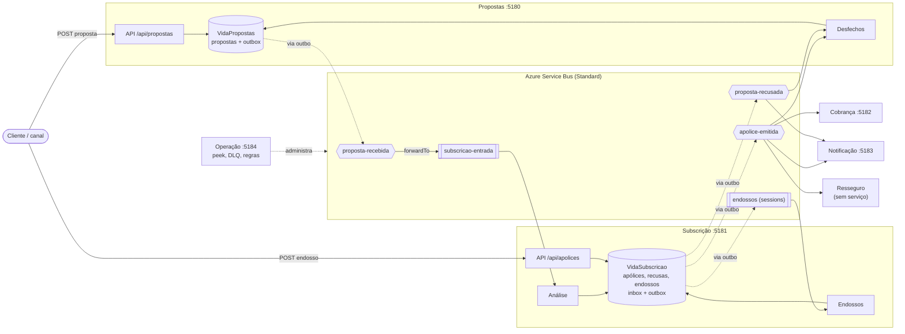

| Serviço | Publica | Consome | Banco |
|---|---|---|---|
| **Propostas** | `proposta-recebida` | `status-aprovada`, `status-recusada` | VidaPropostas |
| **Subscrição** | `apolice-emitida`, `proposta-recusada`, comando em `endossos` | `subscricao-entrada`, `endossos` | VidaSubscricao |
| **Cobrança** | — | `cobranca` | — |
| **Notificação** | — | `notificacao`, `notificacao-recusa` | — |
| **Resseguro** | — | `alto-valor` (as mensagens esperam: não há serviço, de propósito) | — |
| **Operação** | — | nada: descobre as entidades no broker | — |

Regras que o código segue:

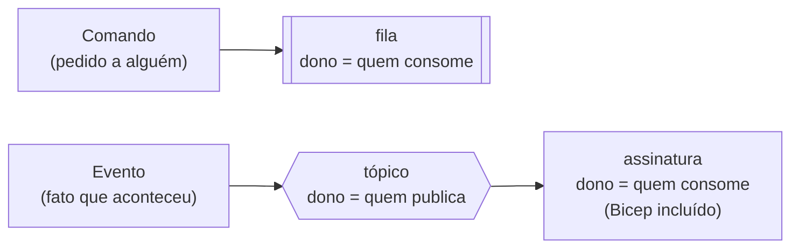

- Um publicador por evento. Cada serviço lê só o seu banco e fica sabendo dos outros por eventos.
- O outbox mora dentro do serviço cujo estado muda: é copiado, não compartilhado.
- Entre squads, código só chega como pacote NuGet versionado (`Vida.*.Contratos`, `Vida.Plataforma`, `Vida.Telemetria`).

---

## 2. Topologia no broker

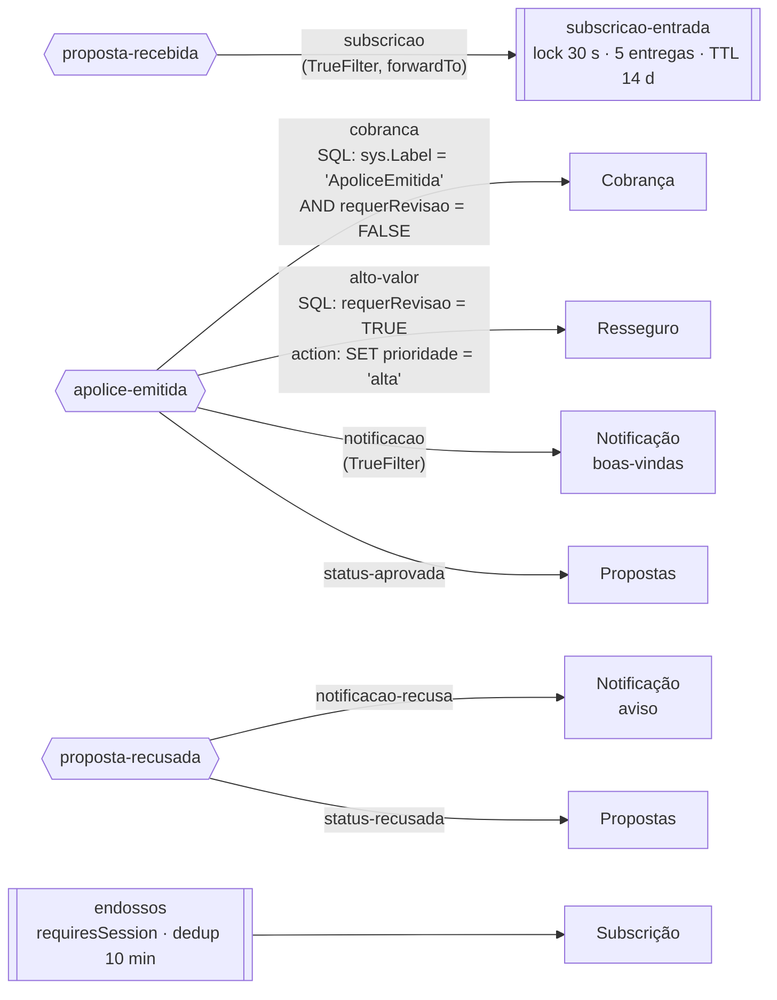

- Toda assinatura: `maxDeliveryCount` 5, DLQ na expiração e em erro de avaliação de filtro.
- `cobranca` e `alto-valor` são complementares: cada apólice cai em exatamente uma das duas.
- `requerRevisao` (capital acima de R$ 1 milhão) é decidido no código (`PoliticaDeRevisao`) e copiado para as
  application properties: **filtro só enxerga propriedades, nunca o corpo**.
- Os filtros de bool são SQL porque, via ARM/Bicep, o correlation filter compara só strings.
- `up.ps1 -ModoDebug` sobe o `lockDuration` para 5 min (o máximo), para parar em breakpoint sem perder o lock.

---

## 3. Fluxos

### 3.1 Proposta: do POST ao desfecho

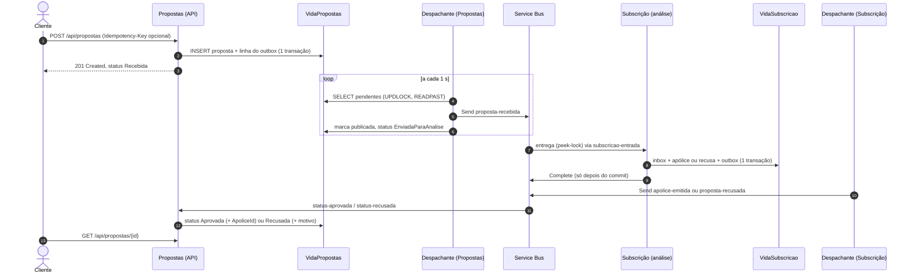

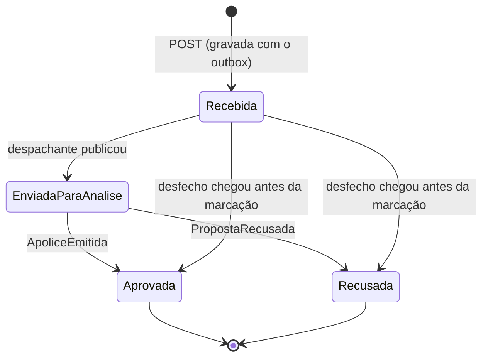

O despachante nunca sobrescreve um desfecho: a recusa é rápida e pode voltar antes de ele marcar `EnviadaParaAnalise`.

### 3.2 A decisão da Subscrição para cada mensagem

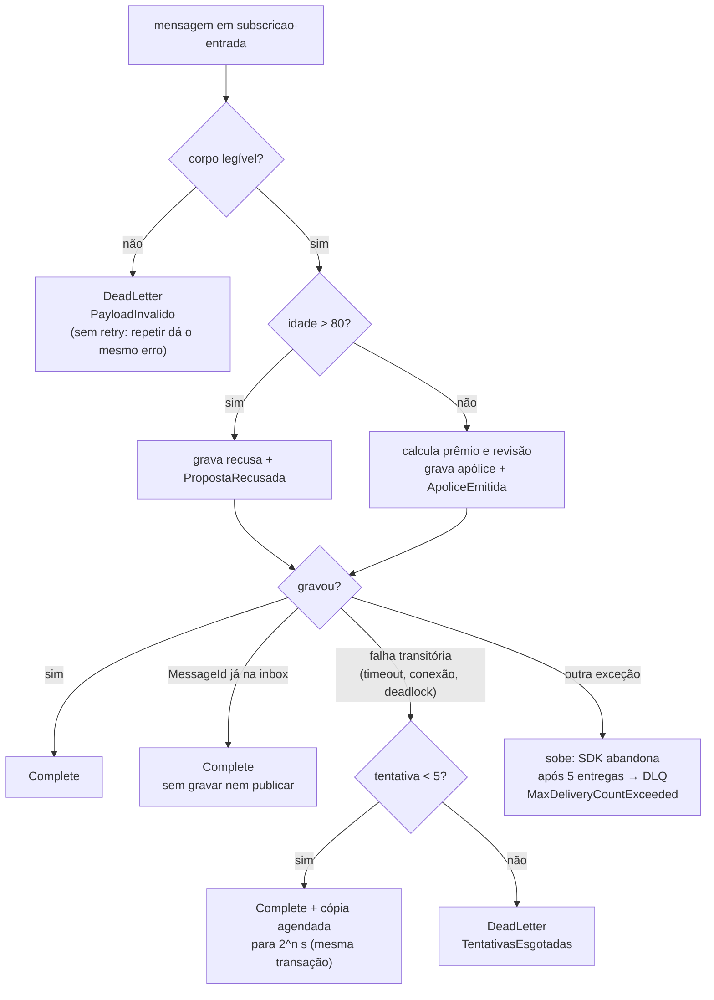

Recusa por regra de negócio é **desfecho**, não falha: nunca vai para a DLQ (lá ninguém avisaria o cliente, e
reprocessar daria a mesma recusa).

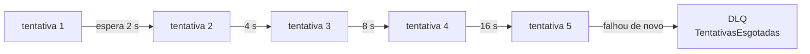

Por que agendar e não `Abandon`: o `Abandon` devolve a mensagem **na hora**, sem espera, e as 5 entregas acabam em
segundos. Por que na **fila** e não no tópico: no tópico, a cópia chegaria a todas as assinaturas.

### 3.3 Endosso: versão gerada no banco, ordem pela sessão

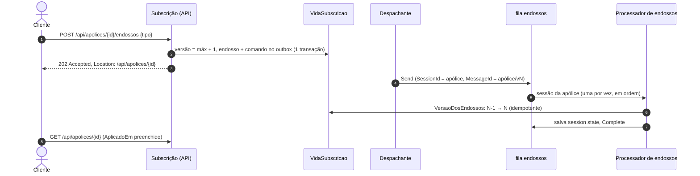

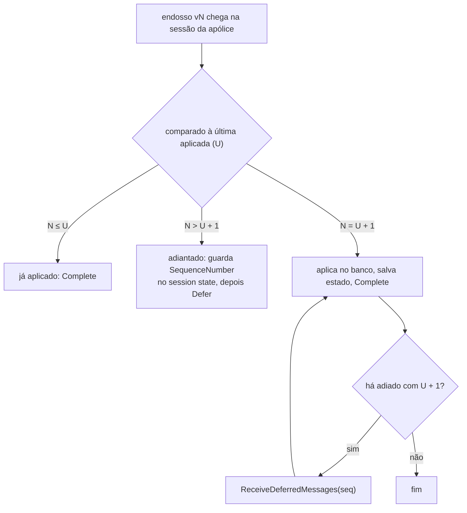

Duas camadas de dedup: o broker descarta o mesmo `MessageId` dentro da janela de 10 min; o consumer descarta
versão `≤ U` em qualquer momento. A ordem banco → session state → Complete importa: nenhum dos dois entra na transação
do Complete, então cada passo precisa aguentar ser repetido.

---

## 4. Garantias e onde cada uma mora

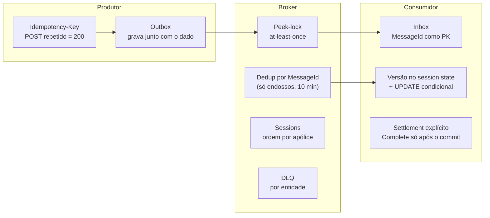

| Problema | Onde aparece | Defesa |
|---|---|---|
| Gravou no banco e não publicou (dual write) | API, análise | **Outbox**: mensagem na mesma transação; despachante publica depois |
| Publicou duas vezes (despachante caiu antes de marcar) | despachantes | `MessageId` estável + inbox / versão no consumidor |
| Cliente repetiu o POST | APIs | `Idempotency-Key` com índice único filtrado |
| Mensagem reentregue após commit (lock perdido, processo caiu) | análise | **Inbox** (detecção de duplicatas do broker não cobre reentrega) |
| Endosso fora de ordem | endossos | Sessions + deferral + `UPDATE ... WHERE VersaoDosEndossos = N - 1` |
| Dependência fora por segundos | análise | Backoff agendado |
| Dado que nunca vai ser processável | todos | DLQ com motivo; reprocessamento deixa os permanentes lá |
| Serviço sem banco | Propostas, Subscrição | **Fail fast**: não sobe |

---

## 5. Conceitos com Kafka e RabbitMQ ao lado

| Azure Service Bus | RabbitMQ | Kafka |
|---|---|---|
| Namespace | vhost / cluster | cluster |
| Fila | fila | tópico com 1 consumer group |
| Tópico + assinaturas | exchange + filas com binding | tópico + vários consumer groups |
| Filtro SQL/correlação + action | binding key / headers exchange | não tem (filtra no consumer) |
| `forwardTo` | exchange-to-exchange / shovel | MirrorMaker / Streams |
| Session (`SessionId`) | single active consumer | partition key (limitado ao nº de partições) |
| Session state | — (guarda fora) | — (state store do Streams) |
| Defer + receive por `SequenceNumber` | — | — (reordena no consumer) |
| Dedup por `MessageId` (janela) | — | producer idempotente (por sessão do producer) |
| `ScheduledEnqueueTime` | plugin delayed-message / DLX + TTL | tópicos de retry por atraso |
| Peek-lock + `Complete` | `autoAck=false` + `ack` | commit de offset |
| `Abandon` | `nack(requeue)` | não commitar / seek |
| DLQ automática por entidade | DLX (configurar) | DLT (implementa você) |
| `MaxConcurrentCalls` / prefetch | `basic.qos` | `max.poll.records` |
| Mensagem sai ao confirmar | idem | **fica no log** (dá para reler) |

O "Kafka da Azure" é o **Event Hubs** (log com offset, aceita o protocolo Kafka). Service Bus é broker
corporativo: settlement por mensagem, DLQ, sessions, transações, filtros.

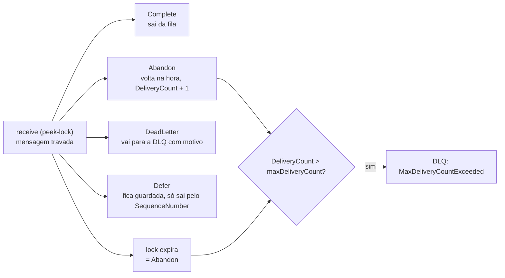

Tiers: **Basic** (só filas), **Standard** (tópicos, sessions, transações, dedup; 256 KB; ~US$ 10/mês, o desta POC),
**Premium** (recursos dedicados, 100 MB, VNet/Private Endpoint, geo-DR; ~US$ 0,93/h por MU).

Autenticação: só Entra ID (`disableLocalAuth: true`), `DefaultAzureCredential` (local: `az login`; no Azure:
managed identity), papel `Azure Service Bus Data Owner` dado pelo Bicep. Um `ServiceBusClient` singleton por app.

---

## 6. Onde está cada coisa

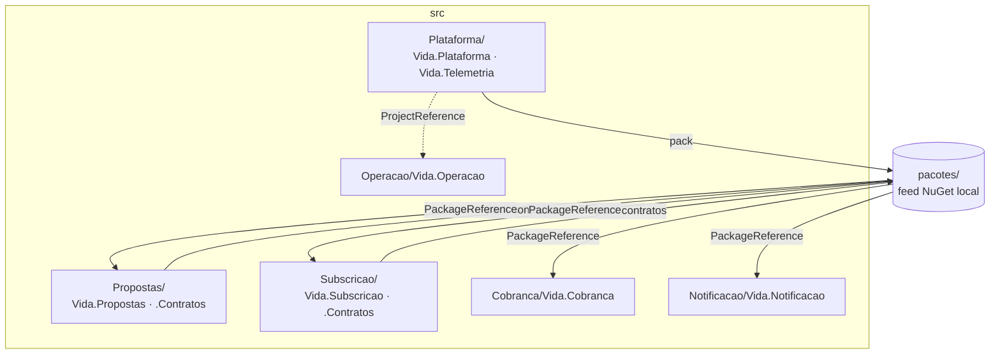

| Peça | Arquivo |
|---|---|
| API de propostas | `src/Propostas/Vida.Propostas/Controllers/PropostasController.cs` |
| Outbox (cada serviço o seu) | `*/Outbox/MensagemDeSaida.cs`, `*/Outbox/DespachanteDoOutbox.cs` |
| Desfechos | `src/Propostas/Vida.Propostas/Desfechos/` |
| Análise + backoff | `src/Subscricao/Vida.Subscricao/Analise/` (`ProcessadorDePropostas`, `RegistroDaAnalise`, `FalhasTransitorias`) |
| API de apólices e endossos | `src/Subscricao/Vida.Subscricao/Controllers/ApolicesController.cs`, `Endossos/RegistroDeEndossos.cs` |
| Sessions e deferral | `src/Subscricao/Vida.Subscricao/Endossos/ProcessadorDeEndossos.cs`, `DecisaoDeEndosso.cs` |
| Liga/desliga, `GET /assinaturas` | `src/Plataforma/Vida.Plataforma/Processamento/` |
| Ferramentas de operação | `src/Operacao/Vida.Operacao/Ferramentas/` |
| Infra | `infra/main.bicep` → `infra/servicos/<servico>.publica.bicep` / `.assina.bicep` |

Infra: quem publica cria o tópico (`*.publica.bicep`); quem consome cria a assinatura (`*.assina.bicep`), recebendo o
nome do tópico como parâmetro (isso ordena o deploy e quebra o ciclo Propostas ↔ Subscrição).
Pegadinha: não redefina a regra `$Default` no Bicep (o deploy passa e a assinatura fica sem regra); dê nome a cada regra.

Contratos: versão publicada é imutável. Mudou, sobe a `<Version>`, `.\publicar-pacotes.ps1`, e cada consumidor
atualiza quando quiser. `Vida.Propostas.Contratos` está na 2.0.0 (só a propriedade `plano`).

---

## 7. Observabilidade

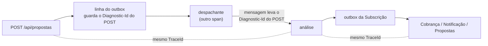

- OpenTelemetry (Microsoft OpenTelemetry Distro): traces, métricas e logs para o **Application Insights** (sem chave,
  Entra ID) e, com `.\iniciar.ps1 -ComAspire`, para o **Aspire Dashboard** local (`http://localhost:18888`, na hora).
- O SDK carrega o contexto W3C em `Diagnostic-Id`. Sem cuidado, o outbox quebraria o trace (o envio acontece no span do
  despachante); por isso a linha guarda o `Diagnostic-Id` do momento da gravação.
- Spans de negócio: `AnalisarProposta`, `ProcessarEndosso`, `PublicarOutbox`. Métricas: `vida.propostas.decididas`,
  `vida.outbox.atraso`, `vida.endossos.adiados`. O polling do outbox roda com a instrumentação suprimida.
- Use `PropostaId`, `ApoliceId`, `MessageId` como placeholders nos logs: viram atributos pesquisáveis.

```kusto
// O fluxo de uma proposta em todos os serviços, a partir do id de negócio
let id = '<propostaId>';
let operacoes = AppTraces | where tostring(Properties.PropostaId) == id | distinct OperationId;
union AppRequests, AppDependencies, AppTraces
| where OperationId in (operacoes)
| project TimeGenerated, AppRoleName, Type, O_que = coalesce(Message, Name), DurationMs
| order by TimeGenerated asc

// Avisos e erros por serviço e classe
AppTraces | where SeverityLevel >= 2
| summarize Quantidade = count() by AppRoleName, Classe = tostring(Properties.CategoryName)

// Atraso do outbox, por minuto
AppMetrics | where Name == "vida.outbox.atraso"
| summarize media = sum(Sum) / sum(ItemCount) by bin(TimeGenerated, 1m)
```

---

## 8. Testes recomendados

### 8.1 Preparação

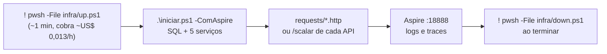

Atalhos usados abaixo: **P** = `localhost:5180`, **S** = `localhost:5181`, **C** = `localhost:5182`,
**N** = `localhost:5183`, **O** = `localhost:5184`. Corpos prontos em `requests/`.

### 8.2 Roteiro

| # | O que mostra | Prepare | Faça | Observe |
|---|---|---|---|---|
| 1 | Caminho feliz, um trace só | — | `POST P/api/propostas` (idade 40, capital 300 000) | `GET P/api/propostas/{id}`: `Recebida` → `Aprovada` com `apoliceId`. Logs de Cobrança e Notificação. No Aspire, um trace do POST até as assinaturas |
| 2 | Recusa é desfecho, não DLQ | — | `POST P/api/propostas` com idade 85 | `GET`: `Recusada` + motivo. Notificação avisa. `GET O/filas` mostra DLQ zerada |
| 3 | Filtros complementares + action | — | proposta com capital 1 500 000 | Cobrança **não** recebe. `GET O/assinaturas/alto-valor/mensagens`: a apólice com `prioridade = alta` |
| 4 | Idempotência na API | — | o mesmo POST duas vezes com a mesma `Idempotency-Key` | 201, depois 200 + `Idempotent-Replayed: true`, mesmo id; uma mensagem só na Subscrição |
| 5 | O produtor não depende do consumidor | `POST S/processadores/propostas/parar` | crie 5 propostas | Todas em `EnviadaParaAnalise`; `GET O/filas/subscricao-entrada/mensagens` lista as 5. `POST S/processadores/propostas/iniciar`: a fila drena e os GETs viram `Aprovada` |
| 6 | Assinante parado não perde nada; os outros seguem | `POST C/processadores/cobranca/parar` (ou encerre a Cobrança) | crie propostas | `GET C/assinaturas`: pendentes sobem. Notificação recebe normalmente. Religue: a Cobrança processa o acúmulo |
| 7 | Backoff com falha real | `POST S/processadores/propostas/parar`, crie 2 propostas, espere 2 s, `docker stop vida-sql` | `POST S/processadores/propostas/iniciar` | Logs da Subscrição: "tentativa agendada para daqui a 2 / 4 / 8 s". `docker start vida-sql` antes da 5ª tentativa (≈ 30 s de esperas, mais o timeout de conexão de cada tentativa): aprovada na seguinte |
| 8 | Tentativas esgotadas + reprocessamento | como no 7, mas deixe o banco parado até a 5ª tentativa falhar | depois `docker start vida-sql` | `GET O/filas/subscricao-entrada/mensagens?dlq=true`: motivo `TentativasEsgotadas`. `POST O/filas/subscricao-entrada/dlq/reprocessar?removerPropriedade=tentativa`: aprovada |
| 9 | API sem banco responde 503 | `docker stop vida-sql` | `POST P/api/propostas` | 503 ProblemDetails genérico (o erro do SQL só no log). `docker start vida-sql` e repita: 201 |
| 10 | Fail fast | a Propostas parada (`.\iniciar.ps1 -Parar`) | `dotnet run --project src\Propostas\Vida.Propostas -- --ConnectionStrings:Propostas=` (linha de comando vence o arquivo local) | O processo termina com "Connection string 'Propostas' não encontrada" |
| 11 | Mensagem venenosa | — | Portal → Service Bus Explorer → `subscricao-entrada` → *Send*: corpo `{"Idade":"trinta"}` | 1 entrega só, DLQ com `PayloadInvalido`. Reprocessar a DLQ **não** a move (motivo permanente) |
| 12 | Competing consumers | suba outra Subscrição: `dotnet run --project src\Subscricao\Vida.Subscricao -- --urls http://localhost:5191` | crie 10 propostas | Cada proposta é processada por **uma** instância (o log mostra `[máquina-pid]`) |
| 13 | Endossos em ordem | apólice do teste 1 | `POST S/api/apolices/{id}/endossos` três vezes | `GET S/api/apolices/{id}`: `versaoDosEndossos = 3`, cada endosso com `aplicadoEm` |
| 14 | Endosso idempotente | — | o mesmo POST com a mesma `Idempotency-Key` | 200 + `Idempotent-Replayed`, mesma versão, nenhum endosso novo |
| 15 | Sessões entre instâncias | duas Subscrições (como no 12); `POST S/processadores/endossos/parar` nas duas | peça endossos para 3 apólices; religue | "Sessão da apólice X aberta nesta instância": cada apólice inteira numa instância, versões em ordem |
| 16 | Deferral | uma apólice descartável (a mensagem manual pula a API e deixa o banco sem o endosso v+2) | Service Bus Explorer → `endossos` → *Send* com Session Id = apólice, Message Id = `{apólice}/v{atual+2}` e corpo `{"ApoliceId":"…","Versao":atual+2,"Tipo":"Teste","SolicitadoEm":"2026-01-01T00:00:00Z"}`; depois peça um endosso pela API (gera a atual + 1) | Log: v+2 "adiado (deferred)"; quando a v+1 é aplicada, "retomando endosso adiado". Métrica `vida.endossos.adiados` |
| 17 | Dedup do broker | `POST S/processadores/endossos/parar` | Service Bus Explorer → `endossos` → envie duas vezes a mesma mensagem (mesmo Session Id e Message Id) | Os dois envios são aceitos; `GET O/filas` conta 1 ativa. Religue o processador |
| 18 | Regras aplicadas pelo Bicep | — | `GET O/assinaturas/regras` | Uma regra por assinatura, com o filtro SQL e a action de `alto-valor`; `subscricao` aparece com `forwardTo` |
| 19 | Peek recusado em origem de forward | — | `GET O/assinaturas/subscricao/mensagens` | 400 explicando: o broker não aceita receiver numa assinatura com `forwardTo` |

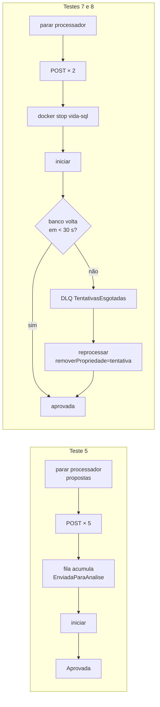

### 8.3 Testes automatizados

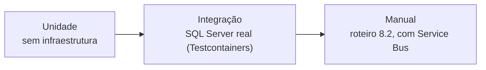

| Projeto | Cobre |
|---|---|
| `tests/Plataforma/Vida.Plataforma.Testes` | nomes de entidades da Operação |
| `tests/Propostas/Vida.Propostas.Testes` | validação do POST, planos, leitura estrita do contrato, ida e volta da linha do outbox |
| `tests/Propostas/Vida.Propostas.Testes.Integracao` | API em memória + SQL real: 201/200/400, idempotência, despachante (envio, backoff, não sobrescreve desfecho), desfechos |
| `tests/Subscricao/Vida.Subscricao.Testes` | prêmio, política de revisão, decisão de endosso, falhas transitórias, contratos |
| `tests/Subscricao/Vida.Subscricao.Testes.Integracao` | inbox (reentrega não duplica), recusa, endossos (versões sequenciais, idempotência, `SessionId` no outbox, aplicação idempotente) |

```powershell
dotnet test                                                  # tudo (os de integração precisam do Docker)
dotnet test --solution src\Subscricao\Subscricao.slnx       # uma squad
dotnet test --project tests\Propostas\Vida.Propostas.Testes  # só unidade
```

O broker é falso nos testes de integração (`ServiceBusFalso` herda de `ServiceBusClient`): o que se prova é o efeito
nas linhas do banco. O comportamento do broker (sessions, dedup, DLQ, filtros) se prova no roteiro 8.2.

---

## 9. Números e limites

| Item | Valor |
|---|---|
| Lock duration | máx. 5 min (POC: 30 s; `-ModoDebug`: 5 min) |
| `maxDeliveryCount` | padrão 10 (POC: 5) |
| Mensagem | 256 KB no Standard, até 100 MB no Premium (payload grande → claim check) |
| Lote | até 1 MB; numa entidade com sessions, **um `SessionId` por envio em lote** |
| Janela de duplicatas | padrão 10 min, mín. 20 s, máx. 7 dias |
| Assinaturas por tópico | até 2.000 |
| Transação do Service Bus | timeout de 2 min |
| `forwardTo` | até 4 saltos; entidade com sessions não pode ser origem |
| Sessions e dedup | só na criação da entidade (mudar = recriar) |

Referências (Microsoft Learn): [filas, tópicos e assinaturas](https://learn.microsoft.com/azure/service-bus-messaging/service-bus-queues-topics-subscriptions) ·
[DLQ](https://learn.microsoft.com/azure/service-bus-messaging/service-bus-dead-letter-queues) ·
[filtros](https://learn.microsoft.com/azure/service-bus-messaging/topic-filters) ·
[sessions](https://learn.microsoft.com/azure/service-bus-messaging/message-sessions) ·
[duplicatas](https://learn.microsoft.com/azure/service-bus-messaging/duplicate-detection) ·
[agendamento](https://learn.microsoft.com/azure/service-bus-messaging/message-sequencing#scheduled-messages) ·
[deferral](https://learn.microsoft.com/azure/service-bus-messaging/message-deferral) ·
[transações](https://learn.microsoft.com/azure/service-bus-messaging/service-bus-transactions) ·
[autoforwarding](https://learn.microsoft.com/azure/service-bus-messaging/service-bus-auto-forwarding) ·
[troubleshooting de envio](https://learn.microsoft.com/azure/service-bus-messaging/service-bus-troubleshooting-guide#troubleshoot-sender-issues)
