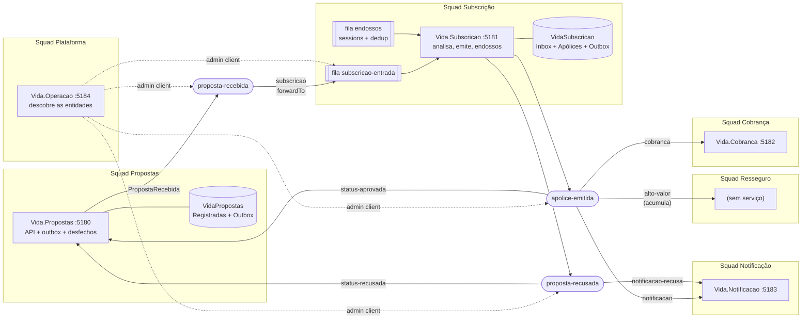
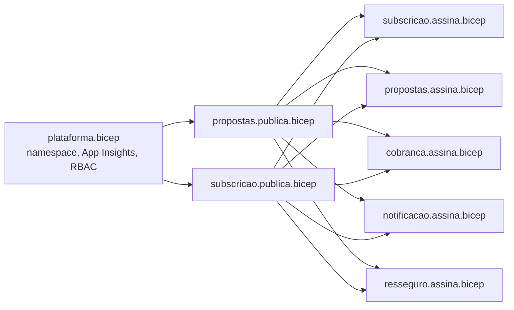
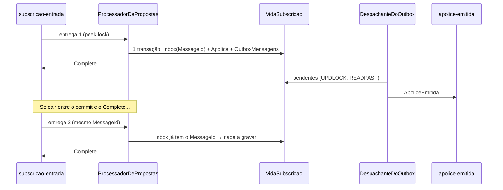
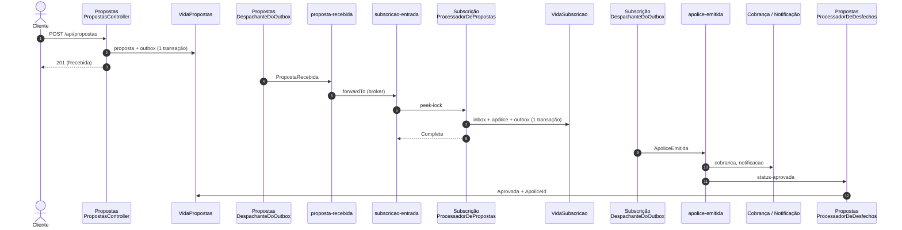
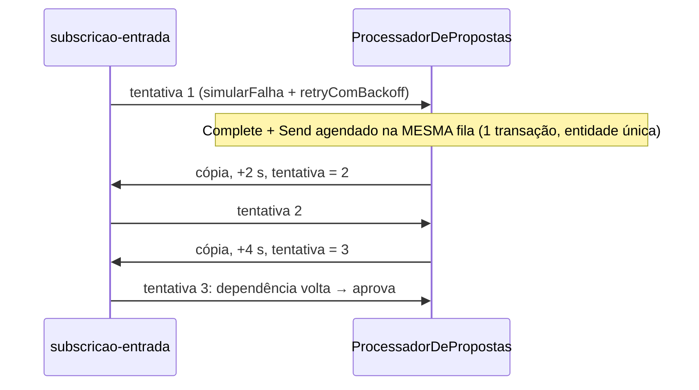

# Fase 7 — Serviços por squad, conversando por eventos

## O modelo mental em uma frase

Até a fase 5 a POC tinha três processos separados por **papel técnico** (quem envia, quem recebe, quem assina) e uma
biblioteca que conhecia a topologia de todo mundo. Agora são serviços separados por **dono de negócio**: cada squad
publica os **fatos** do seu domínio num tópico, assina o que interessa a ela, tem o seu banco e a sua solution, e só
conhece das outras squads os **contratos publicados**, como pacote com versão.

> Os diagramas são Mermaid: o GitHub renderiza direto. No VS Code, a extensão **Markdown Preview Mermaid Support**
> (`bierner.markdown-mermaid`) mostra no `Ctrl+Shift+V`. O passo a passo da mudança está em
> [plano-reestruturacao.md](plano-reestruturacao.md).

## Glossário comparado

| Na POC (Azure Service Bus) | RabbitMQ | Kafka |
|---|---|---|
| Squad publica o evento num **tópico** (`proposta-recebida`) | Publica numa exchange (`topic`/`fanout`) | Produz num tópico |
| Cada squad tem a **sua assinatura** no tópico | Cada serviço tem a sua fila ligada à exchange | Cada serviço tem o seu consumer group |
| Assinatura com `forwardTo` para a **fila de entrada** do serviço | Binding exchange → fila do serviço (é o padrão) | Não precisa: o consumer group já é "a fila" do serviço |
| Retentativa agendada na **fila** do serviço, não no tópico | Republicar na fila do serviço (ou DLX com TTL), não na exchange | Tópico de retry do serviço (`*-retry`), não o tópico original |
| Assinatura sem consumidor (`alto-valor`) acumula | Fila sem consumer acumula | Consumer group que não existe não segura nada: quem chegar depois lê do retention |
| Contrato como **pacote NuGet versionado** | Idem (biblioteca) ou schema documentado | **Schema Registry** (Avro/Protobuf), com regra de compatibilidade |
| Inbox (MessageId já processado) no banco do consumidor | Idem: RabbitMQ também é at-least-once | Idem, ou transação Kafka quando a saída também é Kafka |
| Outbox no banco de quem muda o estado | Idem | Idem, muitas vezes com CDC (Debezium) em vez de polling |

## Aonde chegamos

Regras que o desenho segue:

1. **Comando vai para fila, evento vai para tópico.** A API registra um fato e não sabe quem reage.
2. **Um evento, um publicador.** Propostas publica `proposta-recebida`; Subscrição, `apolice-emitida` e
   `proposta-recusada`. As demonstrações que publicam esses eventos moram no dono.
3. **Cada serviço lê só o próprio banco.** Para saber do outro, recebe eventos.
4. **Quem consome é dono da assinatura**, inclusive no Bicep.
5. **O outbox fica dentro do serviço** que muda o estado. É um padrão, não um serviço nem uma biblioteca.

## Conceitos exercitados

### Comando × evento: a fila mudou de dono

Antes, a API enviava para a fila `propostas`: um **comando** endereçado à Subscrição. Um interessado novo
(antifraude, CRM) exigia mudar a API. Agora a API publica `PropostaRecebida` no tópico `proposta-recebida` e não sabe
quem assina. A fila continua existindo, mas é a **caixa de entrada da Subscrição** (`subscricao-entrada`), alimentada
pela assinatura `subscricao` com `forwardTo`:

- O broker move a mensagem sozinho, **de forma transacional**, sem código (auto-forward; Standard e Premium).
- A retentativa agendada (backoff) e o reprocessamento da DLQ voltam para a **fila**. No tópico, a cópia chegaria a
  todas as assinaturas: um antifraude receberia a tentativa 2, 3, 4...
- O broker **não deixa abrir receiver** (nem peek) na entidade de origem de um forward. A ferramenta de operação recusa
  com explicação e aponta a fila de destino.
- Se o encaminhamento falhar (destino cheio ou desabilitado), a mensagem vai para a **transfer DLQ da origem**
  (`proposta-recebida/Subscriptions/subscricao/$Transfer/$DeadLetterQueue`), não para a DLQ da fila. Quem monitora DLQ
  precisa olhar as duas.
- Encadeamento com mais de **4 saltos** vai para a DLQ.

### Quem publica cria o tópico, quem consome cria a assinatura

O `main.bicep` virou orquestrador de módulos em `infra/servicos/`. Há um ciclo escondido: Propostas assina tópicos da
Subscrição (`status-*`) e a Subscrição assina o de Propostas. Com um módulo por serviço, um dependeria do outro. Por
isso cada serviço tem dois:

A ordem não é escrita à mão: cada "publica" devolve o nome da entidade como output, e cada "assina" o recebe por
parâmetro. A referência cria a dependência. As propriedades comuns das assinaturas ficam numa função exportada
(`padroes.bicep`, `@export()` + `import`). Prova de equivalência: o `what-if` do template novo deu idêntico ao do
antigo contra a mesma infra.

### Assinatura sem serviço

A squad de Resseguro ainda não tem serviço, mas a assinatura `alto-valor` existe (`resseguro.assina.bicep`). As
apólices em revisão esperam lá (TTL de 14 dias, depois DLQ). A Subscrição não sabe e não precisa saber. O painel mostra
a contagem no cartão "Resseguro (sem serviço)", e o peek mostra a `prioridade = 'alta'` que a action da regra colocou.

### Plataforma que descobre, em vez de conhecer

O `Vida.Operacao` (peek, DLQ, reprocessamento, regras) não referencia contrato de nenhuma squad. Ele lista filas,
tópicos e assinaturas pelo `ServiceBusAdministrationClient` a cada chamada, então uma assinatura nova aparece sem mudar
o código dele. Consequências:

- o peek mostra Subject, propriedades e o começo do corpo como texto (não desserializa: não conhece o contrato);
- o reprocessamento recebe `?removerPropriedade=` em vez de saber o que é `simularFalha`;
- o estado do outbox de Propostas **não** está na Operação: o outbox mora no banco de Propostas, e nenhum serviço lê o
  banco de outro (é `GET /demo/outbox`, de Propostas).

### Liga/desliga: o consumidor fora não derruba ninguém

`ProcessadorControlavel` (na plataforma) embrulha um `ServiceBusProcessor` ou `ServiceBusSessionProcessor`, e
`POST /processadores/{nome}/parar` para o consumo sem derrubar o processo. É a demo "Outbox com a Subscrição
desligada": a API segue respondendo 201, o despachante publica, as mensagens esperam na fila; religou, drenou.

### Uma solution por squad, contratos como pacote

Projetos separados não bastam: com `ProjectReference`, cada serviço compila o **código-fonte** dos contratos das
outras squads, e mudar um contrato muda todo mundo no mesmo build. A regra agora:

- **Dentro da squad, `ProjectReference`; entre squads, `PackageReference` com versão.** Pacotes: `Vida.Plataforma`,
  `Vida.LogsAoVivo`, `Vida.Telemetria`, `Vida.Propostas.Contratos`, `Vida.Subscricao.Contratos`.
- **Feed local** (pasta `pacotes/` + `nuget.config`; num cenário real, Azure Artifacts), preenchido por
  `publicar-pacotes.ps1` na ordem das dependências.
- **Package source mapping:** `Vida.*` só pode vir do feed `vida`. Sem isso, um pacote homônimo publicado no nuget.org
  com versão maior seria baixado no lugar do nosso (*dependency confusion*).
- **Versão publicada é imutável.** O restore guarda o pacote no cache global pela versão e nunca mais baixa a mesma:
  republicar "1.0.0 com outra coisa dentro" não chega a quem já restaurou. O script recusa republicar; mudou, sobe a
  `<Version>`.
- Uma `.slnx` por squad em `src/<Squad>/`, e a `ServiceBusPoc.slnx` com tudo, para estudo.

Duas provas feitas na POC:

1. Uma constante nova no contrato da Subscrição compila na Subscrição (dona, `ProjectReference`) e dá `CS0117` na
   Cobrança, que enxerga só a 1.0.0 publicada.
2. A primeira mudança real de contrato (etapa 9): `Vida.Propostas.Contratos` 1.1.0, com a propriedade
   `simularQuedaAposGravar`. A 1.1.0 foi publicada **ao lado** da 1.0.0; a Subscrição passou a referenciar a 1.1.0, e
   Cobrança e Notificação continuaram na 1.0.0 (via `Vida.Subscricao.Contratos`) sem mudar nada.

Detalhe: em Propostas, o próprio contrato chega por dois caminhos (projeto, e como pacote, por dependência do contrato
da Subscrição). O NuGet resolve para o **projeto** (`project.assets.json`: `Vida.Propostas.Contratos -> project`).

### Banco por serviço: inbox + outbox na Subscrição

Na fase 2, a Subscrição concluía a proposta e publicava a apólice numa **transação do broker**
(`EnableCrossEntityTransactions`). Com banco próprio, isso não basta: a transação do Service Bus não inclui o SQL
Server. Agora:

- **Inbox:** o `MessageId` com chave primária, na mesma transação da apólice e do outbox. A consulta antes do insert
  pega o caso comum; a chave primária decide a corrida entre duas instâncias.
- **A detecção de duplicatas do broker não resolve isto:** ela barra um *reenvio* do produtor dentro da janela, não a
  *reentrega* da mesma mensagem depois de um lock perdido ou de uma queda.
- **Outbox copiado, não compartilhado:** o despachante da Subscrição é uma cópia do de Propostas.
- **Efeito colateral bom:** sem publicar dentro da transação do broker, o client com `EnableCrossEntityTransactions`
  e o segundo client "sem transação" deixaram de existir. O retry com backoff continua numa transação, mas Complete e
  Send são na mesma fila, e transação numa entidade só dispensa a opção.
- **Sem banco, a análise não liga:** as propostas esperam na fila em vez de falhar 5 vezes e ir para a DLQ.

Demo: cenário "Queda entre gravar e concluir (inbox)". No banco, depois: 1 apólice, 1 linha na inbox, 1 evento.

## Fluxos para depurar

Com `.\iniciar.ps1 -ComInfra -ModoDebug`, o lock é de 5 min. Configuração do VS Code: **Fluxo completo (todos os
serviços)**.

### Caminho feliz

| Passo | Arquivo |
|---|---|
| POST | `src/Propostas/Vida.Propostas/Controllers/PropostasController.cs` |
| Publicação da proposta | `src/Propostas/Vida.Propostas/Outbox/DespachanteDoOutbox.cs` |
| Análise | `src/Subscricao/Vida.Subscricao/Analise/ProcessadorDePropostas.cs` e `RegistroDaAnalise.cs` |
| Publicação da apólice | `src/Subscricao/Vida.Subscricao/Outbox/DespachanteDoOutbox.cs` |
| Assinantes | `src/Cobranca/.../ProcessadorDeCobranca.cs`, `src/Notificacao/.../ProcessadorDeBoasVindas.cs` |
| Desfecho | `src/Propostas/Vida.Propostas/Desfechos/ProcessadorDeDesfechos.cs` |

### Retry com backoff na caixa de entrada

## Perguntas para revisar

1. **Se a API publica num tópico, para que serve a fila?** É a caixa de entrada do consumidor, não da API: retry e
   reprocessamento voltam para ela sem espalhar cópias para as outras assinaturas.
2. **Como uma squad nova passa a receber propostas?** Cria a assinatura dela no Bicep dela. Ninguém mais muda nada.
3. **Biblioteca compartilhada ou contrato versionado?** Contrato versionado, como pacote (ou schema num registry).
   Biblioteca compartilhada acopla o deploy de todo mundo; pacote deixa cada squad atualizar quando quiser.
   Adição compatível sobe a versão menor; quebra exige versão maior e convivência das duas por um tempo.
4. **E se dois serviços precisarem do mesmo dado?** Cada um guarda a sua projeção a partir dos eventos (como
   Propostas grava o `ApoliceId` vindo de `apolice-emitida`). Não lê o banco do outro e não chama a API dele no
   caminho de escrita.
5. **Por que o outbox não é um serviço central?** Porque ele precisa estar na mesma transação local do dado. Um
   serviço central de outbox seria outro dual write.
6. **At-least-once: onde mora a idempotência?** No consumidor: inbox (MessageId) ou regra de negócio (versão do
   endosso). A detecção de duplicatas do broker só cobre reenvio do produtor dentro da janela.
7. **Ferramenta de operação conhecendo todos os serviços: problema?** Sim: vira gargalo de mudança. Ela descobre a
   topologia no broker.
8. **Dependência circular entre módulos de infraestrutura?** Separar o que cada serviço publica do que ele assina, e
   subir todos os "publica" primeiro.

## Referências

- [Auto-forwarding](https://learn.microsoft.com/azure/service-bus-messaging/service-bus-auto-forwarding)
- [Dead-letter queues (inclusive a transfer DLQ)](https://learn.microsoft.com/azure/service-bus-messaging/service-bus-dead-letter-queues)
- [Transações no Service Bus](https://learn.microsoft.com/azure/service-bus-messaging/service-bus-transactions)
- [Topic filters and actions](https://learn.microsoft.com/azure/service-bus-messaging/topic-filters)
- [Idempotent message processing](https://learn.microsoft.com/azure/architecture/reference-architectures/containers/aks-mission-critical/mission-critical-data-platform#idempotent-message-processing)
- [Transactional Outbox](https://learn.microsoft.com/azure/architecture/databases/guide/transactional-outbox-cosmos)
- [Bicep: import e export](https://learn.microsoft.com/azure/azure-resource-manager/bicep/bicep-import)
- [NuGet: package source mapping](https://learn.microsoft.com/nuget/consume-packages/package-source-mapping)
- [Azure Artifacts (feed NuGet)](https://learn.microsoft.com/azure/devops/artifacts/get-started-nuget)
