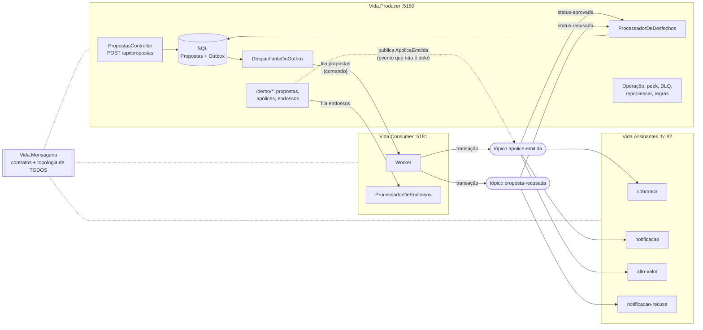
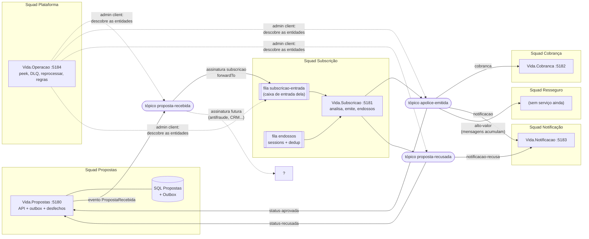
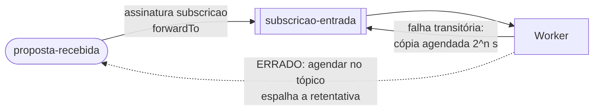
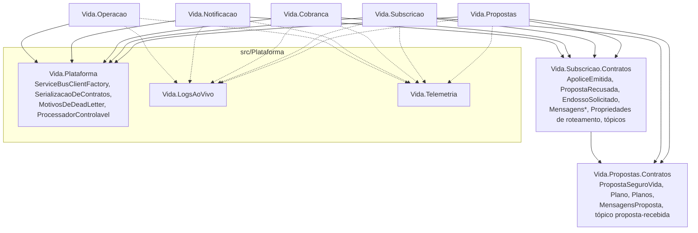
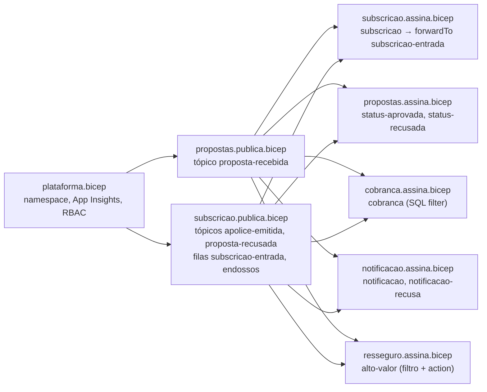
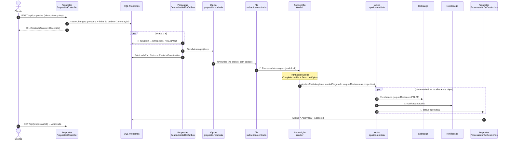
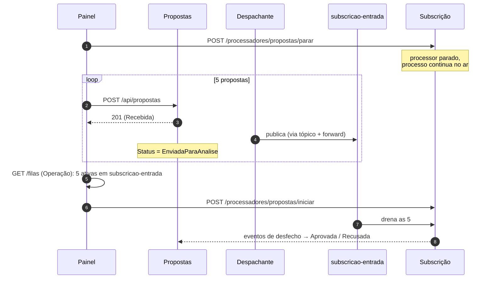
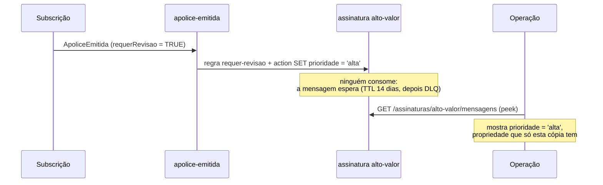
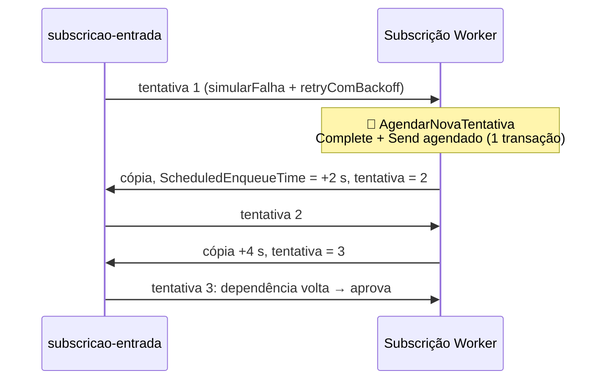
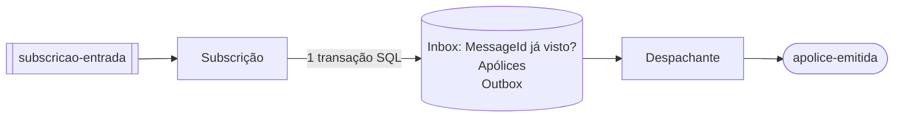

# Plano — serviços por squad (event-driven de verdade)

Plano para dividir a POC em serviços independentes, cada um "de uma squad", que só conversam por eventos.
Escrito no Mac em 2026-10-29, para ser **executado no PC**, etapa por etapa. Cada etapa termina com build, testes e
painel funcionando, e marca o checkbox aqui (é assim que a próxima sessão sabe onde parou).

> Os diagramas são Mermaid: o GitHub renderiza direto. No VS Code, instale a extensão
> **Markdown Preview Mermaid Support** (`bierner.markdown-mermaid`) e abra com `Ctrl+Shift+V`.

## Progresso

- [x] Etapa 0 — Linha de base no PC
- [x] Etapa 1 — Liga/desliga genérico (e o Consumer ganha botão no painel)
- [x] Etapa 2 — Quebrar `Vida.Mensageria` em plataforma + contratos por serviço
- [x] Etapa 3 — Fila `propostas` vira tópico `proposta-recebida` + caixa de entrada da Subscrição
- [x] Etapa 4 — Bicep por serviço (quem publica cria o tópico, quem consome cria a assinatura)
- [ ] Etapa 5 — `Vida.Assinantes` vira `Vida.Cobranca` e `Vida.Notificacao`; `alto-valor` fica sem serviço
- [ ] Etapa 6 — `Vida.Operacao` (ferramentas de operação) e endpoints de demonstração no dono certo
- [ ] Etapa 7 — Painel, `iniciar.ps1`, `launch.json`
- [ ] Etapa 8 — Documentação (nota da fase, README, dicas, CLAUDE.md)
- [ ] Etapa 9 — (Opcional) Banco próprio na Subscrição: outbox + inbox

---

## 1. De onde partimos

Hoje são três processos, mas a fronteira entre eles é técnica ("quem envia", "quem recebe", "quem assina"), não
de negócio. E tudo depende de uma biblioteca, `Vida.Mensageria`, que conhece a topologia inteira.

O que incomoda:

| Problema | Por que importa |
|---|---|
| A API manda um **comando** para uma fila da Subscrição | A API sabe quem vai processar. Um novo interessado (antifraude, CRM) exige mudar a API |
| `Vida.Mensageria` tem contratos e topologia de todo mundo | Mudar um contrato de Cobrança recompila todos os serviços: as squads não são independentes |
| O Producer publica `ApoliceEmitida` (demo) e opera a DLQ dos outros | Cada evento deve ter **um** publicador, o dono do fato |
| Um processo hospeda três assinaturas de squads diferentes | Não dá para mostrar "a squad X ainda não fez o serviço dela" |
| O Consumer só para matando o processo | Difícil mostrar que o outbox continua funcionando com o consumidor fora |

## 2. Aonde queremos chegar

Regras que o desenho segue:

1. **Comando vai para fila, evento vai para tópico.** A API registra um fato (`PropostaRecebida`) e não sabe quem
   reage. Hoje o `Subject` já é `PropostaRecebida` (`TiposDeMensagem`), só o destino era uma fila.
2. **Um evento, um publicador.** Propostas publica `proposta-recebida`; Subscrição publica `apolice-emitida` e
   `proposta-recusada`. Ninguém mais.
3. **Cada serviço lê só o próprio banco.** Para saber de outro, recebe eventos (o `ProcessadorDeDesfechos` já é
   assim). Nada de chamada síncrona (HTTP/gRPC) no caminho de escrita.
4. **Quem consome é dono da assinatura.** A assinatura de Cobrança é da squad de Cobrança, inclusive no Bicep.
5. **O outbox fica dentro do serviço** que muda o estado, no mesmo banco. Ele é um padrão, não um serviço.

### Por que a Subscrição ainda tem uma fila?

A pergunta do começo da conversa: se a API publica num tópico, para que fila? A resposta muda de lugar. A fila
deixa de ser **da API** e vira a **caixa de entrada da Subscrição**:

- A assinatura `subscricao` do tópico tem `forwardTo: subscricao-entrada`. O broker move a mensagem sozinho.
- O retry com backoff (fase 3) agenda uma cópia. Se essa cópia fosse para o **tópico**, iria para **todas** as
  assinaturas (antifraude receberia a tentativa 2, 3, 4...). Para a fila da Subscrição, só ela recebe.
- O reprocessamento da DLQ devolve para essa mesma fila, pelo mesmo motivo.
- A transação entre entidades do `Worker` continua igual: Complete na fila (entidade "via") + envio para o tópico.

> ⚠️ Verificar na documentação (ferramenta `documentation` do Azure MCP, regra do CLAUDE.md) antes de escrever na
> nota da fase: auto-forward de assinatura para fila no mesmo namespace; como o `DeliveryCount` e a DLQ se comportam
> no encaminhamento; transação entre entidades tendo a fila de destino do forward como entidade "via".

## 3. Projetos

| Projeto | Vem de | Conteúdo |
|---|---|---|
| `src/Plataforma/Vida.Plataforma` | `Vida.Mensageria/Conexao`, `SerializacaoDeContratos`, `MotivosDeDeadLetter` | "Chassis" comum a todas as squads. Ganha `ProcessadorControlavel` + `ProcessadoresController` (etapa 1) |
| `src/Plataforma/Vida.LogsAoVivo`, `Vida.Telemetria` | iguais | Só mudam de pasta |
| `src/Propostas/Vida.Propostas.Contratos` | `Contratos/PropostaSeguroVida`, `Dominio/Plano(s)`, `Mensagens/MensagensProposta` | A "linguagem publicada" de Propostas |
| `src/Propostas/Vida.Propostas` | `Vida.Producer` (menos operação e demo de apólice/endosso) | API, outbox, desfechos, demos de proposta |
| `src/Subscricao/Vida.Subscricao.Contratos` | `ApoliceEmitida`, `PropostaRecusada`, `EndossoSolicitado`, `MensagensApolice/Recusa/Endosso`, `Propriedades` | Contratos dos eventos que a Subscrição publica |
| `src/Subscricao/Vida.Subscricao` | `Vida.Consumer` + `CalculadoraDePremio`, `PoliticaDeRevisao` + demos de apólice/endosso | Regras de subscrição ficam **internas** |
| `src/Cobranca/Vida.Cobranca` | parte de `Vida.Assinantes` | Assinatura `cobranca` |
| `src/Notificacao/Vida.Notificacao` | parte de `Vida.Assinantes` | `notificacao` + `notificacao-recusa` |
| `src/Operacao/Vida.Operacao` | `Vida.Producer/Operacao`, `FilaDePropostasController`, `AssinaturasController`, `NamespaceController` | Ferramenta da squad de plataforma |

Num cenário real, os projetos `*.Contratos` seriam **pacotes NuGet versionados** (ou schemas num registry), e não
`ProjectReference`. Na POC fica `ProjectReference`, mas a regra vale: um serviço só referencia os contratos dos
eventos que publica ou consome, nunca o código interno de outro serviço.

`Plano` aparece em `ApoliceEmitida`, então `Vida.Subscricao.Contratos` referencia `Vida.Propostas.Contratos`. É
aceitável (contrato que usa outro contrato).

## 4. Infra: quem publica cria o tópico, quem consome cria a assinatura

Um `main.bicep` vira orquestrador de módulos. `up.ps1` não muda por fora (mesmos parâmetros e outputs).

Existe um ciclo escondido: Propostas assina tópicos da Subscrição (`status-*`), e a Subscrição assina o tópico de
Propostas. Se cada serviço fosse um módulo só, um dependeria do outro. A saída é dividir cada serviço em
**"publica"** (tópicos e filas próprias) e **"assina"** (assinaturas), e subir todos os "publica" antes:

Arquivos em `infra/servicos/<servico>.publica.bicep` e `infra/servicos/<servico>.assina.bicep`, cada um com
`resource namespace ... existing` para achar o namespace. Os comentários didáticos do `main.bicep` atual vão junto
com o recurso que explicam.

Transição: o deploy é incremental, então a fila `propostas` continuaria existindo. Como a infra é recriada a cada
sessão, o caminho mais simples é `down.ps1` + `up.ps1`. No banco local, as linhas antigas do outbox apontam para
`propostas`: `sql-down.ps1 -ApagarDados` antes da etapa 3.

## 5. Fluxos para depurar

Com `.\iniciar.ps1 -ComInfra -ModoDebug` o lock é de 5 min, dá tempo de inspecionar cada passo. 🔴 = breakpoint
sugerido. Os nomes de arquivo são os **novos**; entre parênteses, onde o código está hoje.

### 5.1 Caminho feliz: proposta aprovada

| Passo | Arquivo / método |
|---|---|
| 2 | `Vida.Propostas/Controllers/PropostasController.cs` `CriarAsync` (hoje `Vida.Producer`) |
| 4 | `Vida.Propostas/Outbox/DespachanteDoOutbox.cs` `DespacharLoteAsync` |
| 8 | `Vida.Subscricao/Analise/ProcessadorDePropostas.cs` `ProcessarMensagem` (hoje `Vida.Consumer/Worker.cs`) |
| 10–12 | `Vida.Cobranca/.../ProcessadorDeCobranca.cs`, `Vida.Notificacao/...` (hoje `ProcessadorDeAssinatura.ProcessarApolice`) |
| 12 | `Vida.Propostas/Desfechos/ProcessadorDeDesfechos.cs` `ProcessarAprovacaoAsync` → `RegistroDeDesfechos.AplicarAprovacaoAsync` |

### 5.2 A demo que motivou tudo: Subscrição desligada

### 5.3 O serviço que não existe: `alto-valor`

A Subscrição não sabe e não precisa saber que ninguém consome. É o ponto: publicar não depende de existir quem
assine.

### 5.4 Retry com backoff na caixa de entrada

## 6. Etapas

Cada etapa: o que fazer, critério de pronto, e o que depurar para ver a mudança. Rodar `dotnet build` e
`dotnet test` ao fim de todas.

### Etapa 0 — Linha de base no PC

- `git pull`, `dotnet tool restore`, `dotnet build`, `dotnet test`, `.\iniciar.ps1 -ComInfra`, rodar 2 cenários no
  painel. Anotar o que falhar **antes** de mexer (é o que diferencia "quebrou na reestruturação" de "já estava
  assim no PC").
- **Resultado (2026-10-29):** build ok, 68/68 testes, infra e apps no ar; lote (fase 1), proposta aprovada e
  recusada pela API (fase 4) com desfecho de volta. Já estava assim antes de mexer:
  - aviso CS1570 em `CenariosDePropostasController.cs:60` (`
` sobrando no `///` de `EnviarUmaAsync`);
  - `Porta-Em-Uso` do `iniciar.ps1` não enxergava a porta do Vite (o `netstat` mostra `[::1]:5173` como
    `CLOSED`, mas ela responde 200) e o script derrubava tudo depois de 60 s, também no terminal normal.
    Corrigido: a checagem agora tenta conectar (`TcpClient`), e o `-Parar` acha o Vite sem `-State Listen`.

### Etapa 1 — Liga/desliga genérico

Pequena e independente: já entrega a demo "outbox com consumidor fora".

- Extrair de `Vida.Assinantes/Processamento` um `ProcessadorControlavel` (start/stop de um `ServiceBusProcessor` ou
  `ServiceBusSessionProcessor`) e um `ProcessadoresController` (`GET /processadores`, `POST
  /processadores/{nome}/iniciar|parar`), registrado como application part, no mesmo padrão do `AddLogsAoVivo()`.
  Por enquanto ficam em `Vida.Mensageria`; na etapa 2 vão para `Vida.Plataforma`.
- `Worker` e `ProcessadorDeEndossos` passam a ser controláveis. `Vida.Assinantes` usa o mesmo mecanismo.
- Painel: controle liga/desliga na coluna do Consumer, igual ao do Assinantes.
- Cenário novo em `cenarios.ts`: "Outbox com a Subscrição desligada" (diagrama 5.2).
- **Pronto quando:** parar o Consumer pelo painel, criar propostas, ver a fila crescer e as propostas em
  `EnviadaParaAnalise`, religar e ver todas virarem `Aprovada`/`Recusada`.
- **Resultado (2026-10-29):** `Vida.Mensageria/Processamento/` (`ProcessadorControlavel`, `GerenciadorDeProcessadores`,
  `ProcessadoresController`, `AddProcessadoresControlaveis()`/`AddProcessadorControlavel()`). `Worker`,
  `ProcessadorDeEndossos` e `ProcessadorDeAssinatura` ganharam `CriarProcessador()`; `GerenciadorDeAssinaturas` saiu e
  `POST /assinaturas/{nome}/iniciar|parar` virou `/processadores/{nome}/...` (`GET /assinaturas` ficou, com contagens).
  Cenário "Outbox com o Consumer desligado" (fase 4 no painel). Testado ao vivo: 5 na fila com `propostas` parado,
  0 depois de religar, 4 `Aprovada` + 1 `Recusada`. CLAUDE.md ainda cita as rotas antigas: atualizar na etapa 8.
  Obs.: o Smart App Control do Windows bloqueava as DLLs recém-compiladas (evento 3077/3118 em CodeIntegrity); foi
  desligado no PC.

### Etapa 2 — Plataforma + contratos

Refatoração pura: o comportamento não muda.

- Criar os projetos da seção 3, mover os arquivos, ajustar namespaces (`Vida.Plataforma.Conexao`,
  `Vida.Propostas.Contratos`, ...). `CalculadoraDePremio` e `PoliticaDeRevisao` vão para dentro do Consumer (ainda
  com o nome antigo).
- `src/Directory.Build.props` faz o link de `servicebus.local.json` (e `sqlserver.local.json` só no Producer) para
  todos os executáveis, com `Condition="'$(OutputType)' == 'Exe'"`. Os csproj param de repetir o `<None ...>`, e o
  caminho relativo não quebra quando os projetos descem um nível de pasta.
- Testes: só os `using` e as referências mudam.
- **Pronto quando:** `dotnet test` verde, painel igual ao de antes.
- **Resultado (2026-10-29):** `Vida.Plataforma` (`Conexao`, `Processamento`, `Mensagens`: serialização e motivos de
  DLQ, `Topologia/DescricaoDeRegras`); `Vida.Propostas.Contratos` (`Eventos/PropostaSeguroVida`, `Dominio/Plano(s)`,
  `Mensagens/MensagensProposta` + `PropriedadesDaProposta`); `Vida.Subscricao.Contratos` (`Eventos/ApoliceEmitida`,
  `PropostaRecusada`, `Comandos/EndossoSolicitado`, `Mensagens/*` + `PropriedadesDeRoteamento`, `Topologia/Filas`,
  `Topicos`, `Assinaturas`). `LogsAoVivo` e `Telemetria` em `src/Plataforma/`. Diferenças em relação ao plano:
  - `CalculadoraDePremio` e `PoliticaDeRevisao` ficaram em `Vida.Subscricao.Contratos/Dominio`, marcadas como
    provisórias: a demo `/demo/apolices` do Producer também as usa. Entram no serviço na etapa 6, junto com a demo.
  - `TiposDeMensagem` saiu: cada fábrica tem o seu `Tipo` (`MensagensProposta.Tipo`...), e `Propriedades` virou
    `PropriedadesDaProposta` + `PropriedadesDeRoteamento` (`plano` existe nas duas, uma por mensagem).
  - `Filas`/`Topicos`/`Assinaturas` ficaram nos contratos da Subscrição até deixarem de ser lista global (etapa 6).
  - `src/Directory.Build.props` linka `servicebus.local.json` (todo `Exe`) e `sqlserver.local.json` (quem declara
    `<UsaSqlServerLocal>true</UsaSqlServerLocal>`, hoje só o Producer).
  Build sem avisos, 68/68 testes. Painel não testado ao vivo (infra derrubada); o código dele só mudou um comentário.

### Etapa 3 — Fila vira tópico

A mudança de comportamento principal.

- Bicep (ainda no `main.bicep`; a divisão é na etapa 4): tópico `proposta-recebida`, fila `subscricao-entrada`
  (mesmas propriedades da `propostas`), assinatura `subscricao` com `forwardTo`. Remover a fila `propostas`.
- `PropostasController`, `EnvioDePropostas`, `EnvioSemOutbox`: destino `Topicos.PropostaRecebida`.
- `Worker`: lê `subscricao-entrada`; `AgendarNovaTentativa` envia para `subscricao-entrada` (seção 2).
- `ReprocessamentoDaDlq`: DLQ de `subscricao-entrada` → `subscricao-entrada`.
- `down.ps1`, `sql-down.ps1 -ApagarDados`, `up.ps1`.
- **Pronto quando:** os cenários das fases 1, 3 e 4 funcionam pelo painel; `curl localhost:5180/assinaturas/regras`
  mostra a `subscricao`.
- **Depurar:** 🔴 no despachante e no Worker; no meio, só o broker age (`forwardTo`).
- **Resultado (2026-10-29):** o nome do tópico mora no contrato (`MensagensProposta.Topico`); `Filas.Propostas` virou
  `Filas.SubscricaoEntrada`; `Assinaturas.Subscricao` fica em `Assinaturas.Encaminhadas`, fora do peek. Rotas de
  operação: `/filas/subscricao-entrada/...` (`FilaDeEntradaController`). Testado ao vivo: regras com `subscricao`
  ($Default), API aprovada/recusada com desfecho de volta, lote, Abandon → DLQ após 5 entregas, payload inválido →
  DLQ, reprocessamento (1 movida, 1 mantida), backoff 2 s/4 s na própria fila, endossos fora de ordem, Consumer
  desligado (3 na fila, 3 `Aprovada` ao religar).
  Verificado na documentação (Azure MCP), para a nota da fase: auto-forward de assinatura para fila no mesmo namespace
  é transacional e existe no Standard; o broker não deixa abrir receiver (nem peek) na entidade de origem do forward;
  forward que falha (destino cheio ou desabilitado) vai para a transfer DLQ da origem
  (`<tópico>/Subscriptions/<assinatura>/$Transfer/$DeadLetterQueue`), não para a DLQ do destino; cadeia de mais de
  4 saltos vai para a DLQ.

### Etapa 4 — Bicep por serviço

- Módulos da seção 4. `main.bicep` só orquestra. `az bicep lint -f infra\main.bicep`.
- **Pronto quando:** `up.ps1` em grupo de recursos zerado cria tudo, `curl .../assinaturas/regras` igual ao da
  etapa 3 (em especial as regras de `cobranca` e `alto-valor`, que dão problema com `$Default`).
- **Resultado (2026-10-29):** `infra/servicos/`: `plataforma.bicep`, `propostas.publica/assina`,
  `subscricao.publica/assina`, `cobranca.assina`, `notificacao.assina`, `resseguro.assina`, e `padroes.bicep` com a
  função exportada `propriedadesDeAssinatura(lockDuration)` (`@export()` + `import`), em vez de copiar o objeto.
  A ordem sai das referências: cada "publica" devolve os nomes como output, e cada "assina" os recebe por parâmetro
  (sem `dependsOn` manual). O what-if do template novo é idêntico ao do `main.bicep` antigo contra a mesma infra
  (20 recursos; os "Modify" são ruído de propriedades com valor padrão do servidor, iguais nos dois). `down.ps1` +
  `up.ps1` do zero: plataforma → os dois "publica" → os cinco "assina"; regras iguais às da etapa 3; apólice de
  1,5 mi em `alto-valor` (com `prioridade = alta`) e `notificacao`, não em `cobranca`.

### Etapa 5 — Cobrança, Notificação e o serviço que não existe

- `Vida.Cobranca` (:5182) e `Vida.Notificacao` (:5183), cada um com seu processor sobre `ProcessadorControlavel`.
  Nenhum dos dois conhece a assinatura do outro.
- `alto-valor` fica só no Bicep (`resseguro.assina.bicep`, comentário: "squad de Resseguro, serviço ainda não
  existe"). Apagar `Vida.Assinantes`.
- **Pronto quando:** apólice de alto valor aparece pendente na `alto-valor` e não na `cobranca` (diagrama 5.3).

### Etapa 6 — Operação e demonstrações no dono certo

- `Vida.Operacao` (:5184): peek, DLQ, reprocessar, regras, namespace. Em vez de listas fixas
  (`Assinaturas.Todas`, `TopicoDe`), **descobre** as entidades com `ServiceBusAdministrationClient`
  (`GetQueuesAsync`, `GetTopicsAsync`, `GetSubscriptionsAsync`): a ferramenta de plataforma não precisa saber dos
  serviços.
- `/demo/apolices` e `/demo/endossos/*` vão para `Vida.Subscricao` (ela é dona de `apolice-emitida` e de
  `endossos`). Propostas fica só com as demos de proposta e outbox.
- `Assinaturas`/`Filas`/`Topicos` deixam de existir como lista global: cada contrato expõe o nome do **seu**
  tópico, cada serviço o nome das **suas** assinaturas.
- Renomear `Vida.Producer` → `Vida.Propostas` e `Vida.Consumer` → `Vida.Subscricao` (e `Worker` →
  `Analise/ProcessadorDePropostas`) aqui, quando já não sobra nada fora do lugar.
- **Pronto quando:** `/openapi/v1.json` do Propostas só tem `/api/propostas`; o de Operação tem as ferramentas.

### Etapa 7 — Painel e scripts

- Lista de apps num lugar só (`web/painel/src/apps.ts` + `vite.config.ts`): nome, porta, cor. Colunas geradas
  dessa lista, com opção de esconder uma (cinco colunas apertam a tela).
- Cartão "Resseguro (sem serviço)" com a contagem pendente da `alto-valor`, vinda da Operação.
- `cenarios.ts` (endpoints novos), `origens.ts` (classes novas), `iniciar.ps1` (lista de apps num array),
  `.vscode/launch.json` (uma configuração por serviço + composto "Fluxo completo").
- **Pronto quando:** `.\iniciar.ps1` sobe os cinco serviços e o painel; a trilha liga uma proposta através de
  Propostas → Subscrição → Cobrança/Notificação → Propostas.

### Etapa 8 — Documentação

- `docs/fase-7-servicos-por-squad.md` no estilo das outras, com estes diagramas e comparação com Kafka (tópico +
  consumer groups; cada squad o seu group) e RabbitMQ (exchange + uma fila por serviço).
- `README.md`: tabela de fases (linha 7), estrutura de pastas, portas.
- Notas da fase 7: comando × evento; outbox é padrão, não serviço; dono da assinatura;
  assinatura sem consumidor; contrato versionado × biblioteca compartilhada; ciclo de dependência no Bicep.
- `CLAUDE.md`: arquitetura com os nomes novos; remover a linha que aponta para este plano.

### Etapa 9 — (Opcional) Banco na Subscrição

Se a Subscrição gravar a apólice num banco dela, a transação do Service Bus deixa de bastar (ela não inclui o SQL):

- **Inbox:** tabela com o `MessageId` processado, na mesma transação da apólice. Repetição (at-least-once) = no-op.
- **Outbox:** o mesmo padrão do Propostas, copiado e não compartilhado (cada squad tem o seu).
- Só vale se sobrar tempo: é o melhor exemplo de "por que cada serviço precisa de idempotência na entrada".

## 7. Decisões tomadas (e o que dá para mudar)

| Decisão | Alternativa |
|---|---|
| Tópico `proposta-recebida` + `forwardTo` para a fila da Subscrição | Subscrição lê direto da assinatura; o retry precisaria de filtro `tentativa IS NULL` nas outras assinaturas |
| `alto-valor` sem serviço | Assinatura nova sem serviço (ex.: `antifraude` em `proposta-recebida`) e manter `alto-valor` com código |
| Endossos na Subscrição | Um serviço `Vida.Apolices` separado |
| Monorepo com `ProjectReference` | Repositório por squad e contratos em NuGet (fora do escopo da POC) |
| Fase 7 (a 6 continua "descartada") | Reaproveitar o número 6 |

## 8. Como retomar no PC

1. `git pull` (este arquivo precisa estar commitado e no GitHub).
2. Abrir o Claude Code na pasta do repositório e pedir: "execute a próxima etapa de `docs/plano-reestruturacao.md`".
3. Ao fim de cada etapa: checkbox marcado em **Progresso**, commit, e só depois a próxima.
